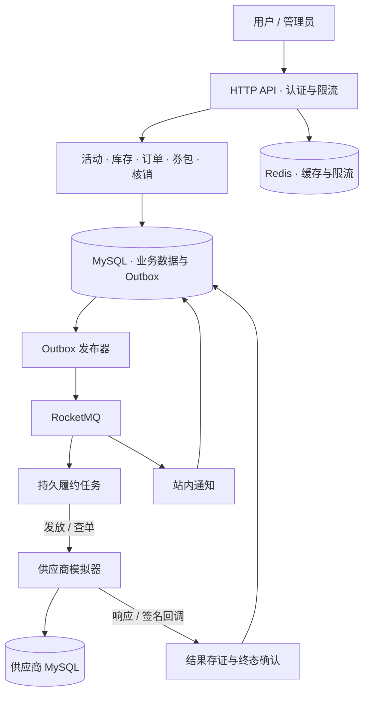

<h1 align="center">VoucherFlow</h1>

<p align="center">
  限量权益发放与核销服务
</p>

<p align="center">
  
  
  
  
  
</p>

<p align="center">
  <a href="#功能特性">功能特性</a> ·
  <a href="#项目架构">项目架构</a> ·
  <a href="#技术栈">技术栈</a> ·
  <a href="#项目结构">项目结构</a> ·
  <a href="#快速开始">快速开始</a> ·
  <a href="#测试验证">测试验证</a> ·
  <a href="#文档">文档</a> ·
  <a href="#开源协议">开源协议</a>
</p>

VoucherFlow 覆盖活动发布、权益领取、库存预留、发放、核销与对账全流程。支持 **本地事务发放** 和 **供应商异步履约**，以库存流水、可靠消息和持久任务串联完整业务链路。

## 功能特性

| 功能           | 实现                                                                         |
| -------------- | ---------------------------------------------------------------------------- |
| **活动管理**   | 草稿编辑、发布、停用，配置领取窗口、核销期限与履约方式                       |
| **库存与幂等** | 事务预留与唯一流水维护库存守恒；重复领取返回原订单，重复核销返回原回执       |
| **双模式发放** | 本地事务直接生成券；供应商模式支持幂等请求、主动查单与签名回调               |
| **可靠消息**   | Transactional Outbox、消费去重、租约恢复、重试与死信重放，驱动履约和站内通知 |
| **对账修复**   | 本地账本核对、跨系统差异扫描、修复预览、版本校验与幂等审计回执               |
| **访问保护**   | 数据库会话、角色授权、CSRF、Redis Lua 限流、活动缓存与有界回源               |
| **运行观测**   | 请求追踪、健康探针、业务指标、故障演练与 k6 性能采样                         |

## 项目架构

主应用采用按业务域分包的 **模块化单体**，Controller → Service → Mapper / Store 分层，由 ArchUnit 校验依赖边界。供应商模拟器独立运行，拥有自己的数据库。



### 两种履约模式

| 模式       | 处理链路                                                                                 |
| ---------- | ---------------------------------------------------------------------------------------- |
| `LOCAL`    | 领取 → 预留库存 → 确认发放 → 生成券，在同一个数据库事务中完成                            |
| `SUPPLIER` | 领取与预留 → Outbox → 消息登记持久任务 → 供应商发放 → 查单 / 回调确认 → 生成券或释放预留 |

### 核心设计

- **库存有账可查**：`总库存 = 可用库存 + 预留库存 + 已发放库存`。活动行锁串行化库存变更，每次预留、确认和释放都有唯一流水。
- **履约可恢复**：订单、预留与事件同事务提交，消费者先登记持久任务再 ACK，执行器通过租约续跑。结果未知时保留预留，由查单和回调确认终态。
- **修复可追溯**：扫描进度与差异持久化；确认、释放前重新查单取证，修复命令通过版本校验与幂等回执记录执行结果。

## 技术栈

| 层面       | 技术                                                       |
| ---------- | ---------------------------------------------------------- |
| 应用       | Java 21 · Spring Boot 4.1.2 · Spring MVC · Bean Validation |
| 数据       | MySQL 8.4 · MyBatis Starter 4.1.0 · Spring JDBC · Flyway   |
| 缓存与消息 | Redis 7.4.2 · Lua · RocketMQ 5.3.2 / Java Client 5.2.2     |
| 安全       | Spring Security · Spring Session JDBC                      |
| 监控       | Spring Boot Actuator · Micrometer                          |
| 测试       | JUnit Jupiter · Testcontainers · ArchUnit · k6             |
| 构建与部署 | Maven Wrapper · Docker Compose · PowerShell 7              |

## 项目结构

```text
VoucherFlow/
├── src/main/
│   ├── java/com/example/voucherflow/
│   │   ├── campaign/          # 活动管理与缓存
│   │   ├── inventory/         # 库存与流水
│   │   ├── issuance/          # 领取与订单
│   │   ├── fulfillment/       # 履约任务与供应商接入
│   │   ├── redemption/        # 券包与核销
│   │   ├── outbox/            # 事件发布、消费与重放
│   │   ├── notification/      # 站内通知
│   │   ├── reconciliation/    # 对账与修复
│   │   ├── identity/          # 身份与权限
│   │   ├── protection/        # 限流与准入
│   │   ├── common/            # 响应、错误、分页与追踪
│   │   └── infrastructure/    # 调度、消息运行时与指标
│   └── resources/
│       ├── db/migration/      # Flyway 数据迁移
│       ├── mapper/            # MyBatis XML
│       └── redis/             # Lua 脚本
├── src/test/                  # 单元、集成、架构与恢复测试
├── supplier-simulator/        # 独立供应商服务与协议测试
├── scripts/                   # 启动、演示、验证、诊断与备份
├── perf/                      # k6 详情查询与领取场景
├── deploy/                    # 容器与 RocketMQ 配置
├── docs/                      # API、运行手册与供应商协议
├── compose.yaml               # 本地依赖编排
├── Dockerfile                 # 主应用镜像
├── .env.example               # 环境变量模板
└── pom.xml                    # 主应用构建与依赖
```

## 快速开始

本地脚本环境：**Windows · JDK 21 · PowerShell 7 · Docker Compose（Linux 容器）**。在项目根目录执行：

```powershell
.\scripts\setup-local.ps1   # 生成本地配置与凭证
.\scripts\dev-up.ps1        # 启动 MySQL、Redis
.\scripts\run-app.ps1       # 启动主应用
```

主应用地址为 `http://localhost:8080`。管理员 `admin-demo`、普通用户 `user-demo` 的密码保存在 `.env`。

另开终端，一条命令体验活动发布、重复领取、券包查询、幂等核销与库存对账：

```powershell
.\scripts\demo-flow.ps1
```

<details>
<summary><strong>供应商履约与故障恢复演示</strong></summary>

完成配置初始化后，停止已运行的主应用，启动供应商数据库与 RocketMQ：

```powershell
.\scripts\dev-up.ps1 -Supplier
```

分别在两个终端启动模拟器与主应用。模拟器使用 `8090` 端口，`-Faults` 开启本次演示所需的故障控制：

```powershell
# 终端一
.\scripts\run-supplier.ps1 -Faults

# 终端二
.\scripts\run-app.ps1 -Supplier
```

在第三个终端执行演示，验证响应丢失后的查单恢复、明确拒绝后的库存释放及最终对账：

```powershell
.\scripts\demo-supplier.ps1
```

</details>

<details>
<summary><strong>完整容器运行</strong></summary>

完成配置初始化并停止宿主机应用后，先构建 JAR，再启动应用、模拟器及依赖容器：

```powershell
.\scripts\verify.ps1
.\scripts\container-up.ps1 -Build
```

容器配置与运行方式见[运行手册](docs/operations.md#容器运行)。

</details>

## 测试验证

| 命令                             | 验证内容                                                               |
| -------------------------------- | ---------------------------------------------------------------------- |
| `.\scripts\verify.ps1`           | 主应用与模拟器的编译、单元测试、架构约束、MySQL / Redis 集成测试及打包 |
| `.\scripts\verify-messaging.ps1` | RocketMQ 发送、消费、死信与重放                                        |
| `.\scripts\verify-recovery.ps1`  | 独立进程中断与重启后的任务恢复                                         |
| `.\scripts\demo-repair.ps1`      | 隔离环境中的差异扫描、修复与命令重放                                   |

性能场景见 [perf/](perf/)，采样入口为 [measure-detail.ps1](scripts/measure-detail.ps1) 与 [measure-claim.ps1](scripts/measure-claim.ps1)。

## 文档

- [API 参考](docs/api.md)：认证、接口、状态与错误码。
- [供应商协议](docs/supplier-contract.md)：幂等请求、查单、签名回调与故障控制。
- [运行手册](docs/operations.md)：环境配置、监控、部署、备份恢复与容量边界。

## 开源协议

本项目原创内容采用 [MIT License](LICENSE)，版权署名为 `2026 VoucherFlow contributors`。

Maven Wrapper 等第三方组件遵循各自的许可证和版权声明。
